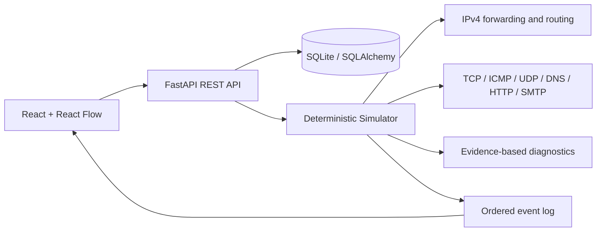

# Architecture

The backend owns topology validation, protocol execution, forwarding decisions, metrics and diagnostic findings. The browser renders returned events and does not decide packet outcomes.
